# Лаба 3 — Платформа для shop

## Часть 0. Сервисы

| | `api` | `worker` |
|---|---|---|
| Эндпоинты | `GET /health`, `POST /order`, `GET /orders`, `GET /metrics` | `GET /health`, `GET /metrics` |
| Работа | хранит заказы в Postgres, сам создаёт таблицу при старте | раз в 2 с забирает пачку новых заказов и помечает `processed` |
| `HEALTH_FAIL=true` | `/health` отвечает 503 | то же |
| Метрики | RED, `shop_orders_created_total`, `shop_build_info{version}` | `shop_orders_processed_total`, `shop_orders_pending`, `shop_worker_batch_errors_total`, `shop_worker_last_success_timestamp_seconds` |

---

## Часть 1. Ограждения на кластер: Kyverno

> Виверна - всё верно

Задача — сделать так, чтобы кластер сам не принимал деплои, нарушающие
правила, без ручного ревью каждого YAML.

### Почему Kyverno

| | Kyverno | OPA / Gatekeeper |
|---|---|---|
| Язык правил | Kubernetes-манифесты; в новых типах — CEL, тот же язык, что встроенный `ValidatingAdmissionPolicy` | Rego — отдельный язык, который надо осваивать |
| Применение к контроллерам | autogen: правило для Pod само распространяется на Deployment, StatefulSet, Job, CronJob | шаблоны пишутся отдельно, на Pod или на каждый контроллер |
| Сверх валидации | мутация, генерация ресурсов, проверка подписей образов, очистка | в основном валидация |
| Порог входа | ниже — читается как обычный YAML | выше, зато Rego гибче для сложной логики |

Для одного магазина и шести правил гибкость Rego не нужна, а читаемость и
autogen нужны: `helm install` должен падать на Deployment с понятной
ошибкой, а не плодить ReplicaSet, который не может создать ни одного пода.

**Находка по дороге.** В Kyverno 1.19 классический `ClusterPolicy`
(`kyverno.io/v1`), на котором написано большинство туториалов, официально
объявлен устаревшим: по плану
[kyverno/kyverno#17214](https://github.com/kyverno/kyverno/issues/17214) в
1.20 создание политик старого типа будет отклоняться, в 1.21 их удалят.
Замена — типы на CEL из `policies.kyverno.io/v1`. Поэтому все правила здесь —
`ValidatingPolicy`. Формат сверен со схемой CRD из самого чарта.

### Установка

Kyverno 1.19.1 (чарт `kyverno/kyverno` 3.9.1), по одной реплике каждого
контроллера ([`helm/kyverno.yaml`](helm/kyverno.yaml)). В продакшене
admission-контроллер держат в трёх репликах: при его недоступности
(`failurePolicy: Fail`) кластер перестаёт принимать изменения в
подконтрольных namespace.

```bash
helm repo add kyverno https://kyverno.github.io/kyverno/
helm upgrade --install kyverno kyverno/kyverno --version 3.9.1 \
  -n kyverno --create-namespace -f helm/kyverno.yaml --wait
kubectl -n kyverno get pods
```

```text
level=ERROR msg="failed to record the release" error="update: failed to update: etcdserver: request timed out"
STATUS: deployed
NAME                                             READY   STATUS    RESTARTS   AGE
kyverno-admission-controller-769b8f7647-rkwbg    1/1     Running   0          2m35s
kyverno-background-controller-86d8df7447-x86nj   1/1     Running   0          2m35s
kyverno-cleanup-controller-86c886ffff-qntdf      1/1     Running   0          2m35s
kyverno-reports-controller-57c7978d69-wh68r      1/1     Running   0          2m35s
```

```bash
helm upgrade kyverno kyverno/kyverno --version 3.9.1 -n kyverno -f helm/kyverno.yaml --wait
```

```text
REVISION: 2
kyverno-admission-controller-…  kyverno-pre  {'requests': {'cpu': '10m', 'memory': '64Mi'}}
kyverno-admission-controller-…  kyverno      {'requests': {'cpu': '100m', 'memory': '128Mi'}}
kyverno-background-controller-… controller   {'requests': {'cpu': '100m', 'memory': '64Mi'}}
kyverno-cleanup-controller-…    controller   {'requests': {'cpu': '100m', 'memory': '64Mi'}}
kyverno-reports-controller-…    controller   {'requests': {'cpu': '100m', 'memory': '64Mi'}}
```

### Охват политик

Есть два способа ограничить политики «нашим стеком»:

- **opt-in** — правила действуют только в namespace с меткой. Каждый новый
  namespace по умолчанию не защищён, и достаточно забыть метку;
- **opt-out** — правила действуют везде, кроме системных namespace.

Выбран **opt-out**: исключены `kube-system`, `kube-public`,
`kube-node-lease`, `kyverno`, `monitoring` и `cnpg-system` — компоненты
кластера и стек мониторинга с образами из `quay.io` и `docker.io`, которые
мы не контролируем. Наш стек под контролем, а любой новый namespace защищён
сразу. Одна политика — запрет `:latest` — действует только в продакшене:
namespace `shop` помечен `env: prod`
([`policies/00-namespace-shop.yaml`](policies/00-namespace-shop.yaml)).

### Правила

Все правила — на Pod, с `validationActions: [Deny]`; autogen распространяет
их на контроллеры. Init-контейнеры проверяются вместе с обычными.

| Политика | Что требует | Польза |
|---|---|---|
| [`require-resource-limits`](policies/01-require-resource-limits.yaml) | `limits.cpu` и `limits.memory` у каждого контейнера | контейнер без лимитов может занять всю ноду: одна утечка памяти — и kubelet выселяет соседей |
| [`restrict-image-registries`](policies/02-restrict-image-registries.yaml) | образы только из `shop.local/` и `ghcr.io/cloudnative-pg/` | образ из произвольного реестра — непроверенный код в кластере; список разрешённых делает это явным решением |
| [`require-labels`](policies/03-require-labels.yaml) | метки `app.kubernetes.io/name` и `app.kubernetes.io/part-of` | по меткам находят всё остальное: Service, ServiceMonitor, NetworkPolicy, дашборды; без них непонятно, чей под |
| [`disallow-privileged`](policies/04-disallow-privileged.yaml) | никакого `privileged: true` | privileged снимает почти всю изоляцию: все capabilities, без seccomp, доступ к устройствам хоста |
| [`require-run-as-non-root`](policies/05-require-run-as-non-root.yaml) | `runAsNonRoot: true` на поде или каждом контейнере | root в контейнере — root ядра хоста; kubelet откажется запускать образ с uid 0 |
| [`disallow-latest-tag-in-prod`](policies/06-disallow-latest-tag-in-prod.yaml) | в `env: prod` — фиксированный тег, не `:latest`, или дайджест | `:latest` — не версия: поды одного Deployment могут крутить разный код, а `helm rollback` некуда откатывать |

Пара мест, где CEL требует аккуратности:

- в разрешённых реестрах — префикс с косой чертой: `shop.local/`, иначе
  прошёл бы `shop.local.evil.com/x`;
- «тег есть» — это `:` после последнего `/` (`matches(':[^/]+$')`), иначе
  порт реестра в `host:5000/img` сошёл бы за тег;
- у `runAsNonRoot` настройка контейнера перекрывает настройку пода в обе
  стороны — поэтому сначала проверяется контейнер, и только если там не
  задано, — под.

```bash
kubectl apply -f policies/
kubectl get validatingpolicies.policies.kyverno.io
```

```text
NAME                          AGE   READY
disallow-latest-tag-in-prod   11s   true
disallow-privileged           12s   true
require-labels                12s   true
require-resource-limits       12s   true
require-run-as-non-root       11s   true
restrict-image-registries     12s   true
```

`READY true` значит, что Kyverno скомпилировал CEL-выражения.

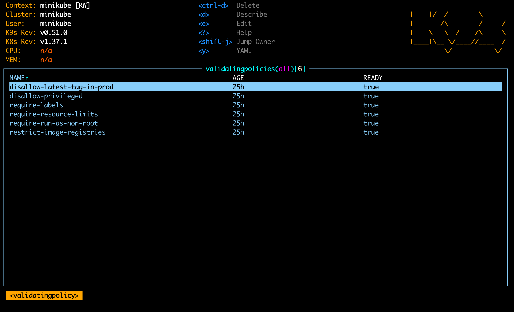

### Проверка: шесть нарушителей

За основу взят эталонный под [`policies/good.yaml`](policies/good.yaml),
который проходит все правила, и из него сделаны шесть копий, в каждой
сломано ровно одно ([`policies/bad/`](policies/bad/)). Так видно, что отказ
вызван именно этим нарушением. Проверка — server-side dry-run: запрос
проходит весь путь admission, включая Kyverno, но в etcd ничего не пишется.

```bash
for f in policies/good.yaml policies/bad/*.yaml; do kubectl apply --dry-run=server -f $f; done
```

```text
== good.yaml
   pod/good created (server dry run)
== bad/1-no-limits.yaml
   admission webhook "vpol.validate.kyverno.svc-fail-16fe81c1" denied the request: Policy require-resource-limits failed: every container must set resources.limits.cpu and resources.limits.memory
== bad/2-foreign-image.yaml
   ... Policy restrict-image-registries failed: images must come from shop.local/, ghcr.io/cloudnative-pg/; got: docker.io/library/nginx:1.29
== bad/3-no-labels.yaml
   ... Policy require-labels failed: missing labels: app.kubernetes.io/part-of
== bad/4-privileged.yaml
   ... Policy disallow-privileged failed: privileged containers are not allowed
== bad/5-run-as-root.yaml
   ... Policy require-run-as-non-root failed: set securityContext.runAsNonRoot: true on the pod or on every container
== bad/6-latest-tag.yaml
   admission webhook "vpol.validate.kyverno.svc-fail-2c252f27" denied the request: Policy disallow-latest-tag-in-prod failed: in env=prod images need a fixed tag (not :latest) or a digest
```

Каждый нарушитель отклонён своей политикой. У `disallow-latest-tag-in-prod`
другой webhook: у неё свой `namespaceSelector`, и Kyverno регистрирует её
отдельно.

Ещё три проверки — autogen, opt-out и «только прод»:

```text
== autogen: Deployment без лимитов в shop
   admission webhook ... denied the request: Policy require-resource-limits failed: every container must set ...
== opt-out: privileged-под в monitoring
   pod/bad-privileged created (server dry run)
== только прод: :latest в default (не env=prod)
   pod/bad-latest-tag created (server dry run)
== а чужой образ в default — всё равно нельзя
   admission webhook ... denied the request: Policy restrict-image-registries failed: ...
   autogen: CronJob, DaemonSet, Deployment, ReplicaSet, StatefulSet, Job
```

- Deployment отклонён на уровне самого Deployment — autogen работает.
- Системные namespace не тронуты.
- `:latest` вне прода разрешён, но общие правила действуют везде.

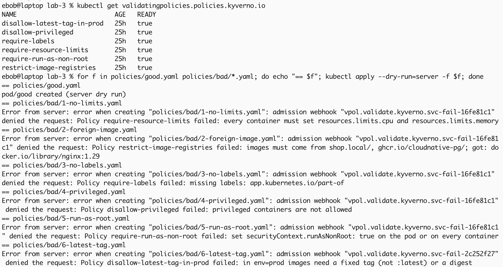

---

## Часть 2. Чарт api и worker

### Образы

Образы собираются прямо в кластер под именем из политики доверенных
реестров — `shop.local/…`:

```bash
make images VERSION=1.0.0
```

```text
error: flag provided but not defined: -build-arg
```

`minikube image build` передаёт опции сборщику того рантайма, что стоит на
ноде. Здесь это containerd, а значит BuildKit (`buildctl`), и build arg в
его синтаксисе — `--build-opt=opt=build-arg:VERSION=1.0.0`, а не docker-овый
`build-arg=…`. После исправления [`Makefile`](Makefile):

```text
shop.local/worker:1.0.0
shop.local/api:1.0.0
```

### Чарт

[`chart/shop/`](chart/shop/): `Chart.yaml`, `values.yaml`, шаблоны
[`api.yaml`](chart/shop/templates/api.yaml) и
[`worker.yaml`](chart/shop/templates/worker.yaml) (Deployment + Service),
общее — в [`_helpers.tpl`](chart/shop/templates/_helpers.tpl).

Что в шаблонах заложено под ограждения:

| Политика | Как выполнена |
|---|---|
| `require-resource-limits` | `resources.limits` для каждого компонента в `values.yaml` |
| `restrict-image-registries` | образ собирается из `registry: shop.local` и имени компонента |
| `require-labels` | хелпер `shop.labels`: `app.kubernetes.io/name`, `part-of: shop`, а также `component`, `version`, `managed-by`, `helm.sh/chart` |
| `disallow-privileged` | хелпер `shop.containerSecurityContext`: privileged не задан, `allowPrivilegeEscalation: false`, `capabilities.drop: [ALL]` |
| `require-run-as-non-root` | `runAsNonRoot: true` на поде и на контейнере, `runAsUser: 65534` |
| `disallow-latest-tag-in-prod` | тег в `values.yaml` — `"1.0.0"`, без значения по умолчанию `latest` |

Что заложено под задачи части:

- **Пробы** на `/health`: readiness каждые 2 с — новый под получает трафик,
  только когда отвечает; liveness с задержкой 5 с — зависший под
  перезапускается.
- **Rolling update по одному:** `maxSurge: 1`, `maxUnavailable: 0` — новый
  под должен пройти readiness раньше, чем уберут старый. Сломанная версия
  поэтому зависает, а старые поды продолжают работать.
- **`progressDeadlineSeconds: 120`** — Deployment признаёт зависший rollout
  через 2 минуты, а не через 10 по умолчанию.
- **`preStop: sleep 5`.** Удаление пода из endpoints Service и SIGTERM
  происходят одновременно; пять секунд дают изменению дойти до всех
  kube-proxy, прежде чем сервер перестанет принимать соединения. Образ —
  `FROM scratch`, бинарника `sleep` в нём нет, поэтому используется
  встроенное действие `preStop.sleep`, а не `exec`.

```bash
helm lint chart/shop
```

```text
==> Linting shop
[INFO] Chart.yaml: icon is recommended
1 chart(s) linted, 0 chart(s) failed
```

### Ограждения ловят и наш чарт

Сначала — установка с нарушением: тег подменён на `latest`.

```bash
helm install shop chart/shop -n shop --set api.image.tag=latest
```

```text
Error: INSTALLATION FAILED: server-side apply failed for object shop/shop-api apps/v1, Kind=Deployment: admission webhook "vpol.validate.kyverno.svc-fail-2c252f27" denied the request: Policy disallow-latest-tag-in-prod failed: in env=prod images need a fixed tag (not :latest) or a digest
```

Отказ пришёл на сам Deployment — autogen в действии, `helm install` падает
сразу и с понятной причиной. Релиз остался в состоянии `failed`, а часть
объектов (Service, Deployment `worker`) успела создаться — поэтому
`helm uninstall` и чистая установка:

```bash
helm uninstall shop -n shop
helm install shop chart/shop -n shop --wait
kubectl -n shop get deploy,pods,svc
```

```text
STATUS: deployed
REVISION: 1
NAME                          READY   UP-TO-DATE   AVAILABLE   AGE   IMAGES
deployment.apps/shop-api      3/3     3            3           4s    shop.local/api:1.0.0
deployment.apps/shop-worker   2/2     2            2           4s    shop.local/worker:1.0.0

NAME                               READY   STATUS    RESTARTS   AGE
pod/shop-api-7bc8c99447-2qh26      1/1     Running   0          4s
pod/shop-api-7bc8c99447-ftrwx      1/1     Running   0          4s
pod/shop-api-7bc8c99447-rhh6r      1/1     Running   0          4s
pod/shop-worker-6fc4fbf997-485p8   1/1     Running   0          4s
pod/shop-worker-6fc4fbf997-zl5dm   1/1     Running   0          4s

NAME                  TYPE        CLUSTER-IP       PORT(S)
service/shop-api      ClusterIP   10.111.156.147   8080/TCP
service/shop-worker   ClusterIP   10.102.93.127    8080/TCP
```

Чистая установка, ни одного отказа от Kyverno.

Позже, после перезагрузки ноутбука, я хотел повторить отказ на живом
релизе без `helm install` (он снова оставил бы релиз в `failed`) — через
server-side dry-run, который проходит всю цепочку admission, но ничего не
пишет в etcd. Первая попытка неожиданно **прошла**:

```bash
helm template shop chart/shop -n shop --set api.image.tag=latest \
  | kubectl apply --dry-run=server -f -
```

```text
deployment.apps/shop-api created (server dry run)
deployment.apps/shop-worker created (server dry run)
```

Подсказка — слово `created`: объекты уже существуют, должно было быть
`configured`. `helm template -n shop` не пишет `metadata.namespace` в
манифесты (namespace подставляет сам Helm при установке), и `kubectl`
отправил их в namespace текущего контекста — `default`. А у `default` нет
метки `env: prod`, так что `disallow-latest-tag-in-prod` по своему
`namespaceSelector` его не касается. Политика сработала ровно так, как
написана; ошибся запрос.

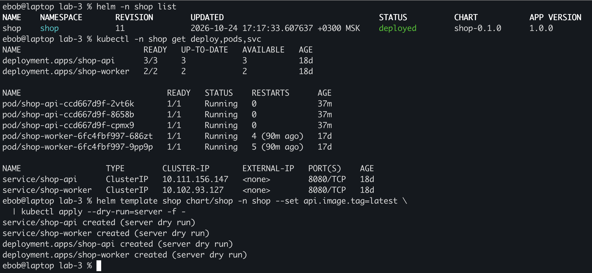

С явным `-n shop` (и `--server-side`, чтобы не было предупреждений про
отсутствующую аннотацию `last-applied-configuration` — объекты создавал
Helm, а не `kubectl apply`):

```bash
helm template shop chart/shop -n shop --set api.image.tag=latest \
  | kubectl apply --server-side --force-conflicts -n shop --dry-run=server -f -
```

```text
service/shop-api serverside-applied (server dry run)
service/shop-worker serverside-applied (server dry run)
deployment.apps/shop-worker serverside-applied (server dry run)
Error from server: admission webhook "vpol.validate.kyverno.svc-fail-2c252f27" denied the request: Policy disallow-latest-tag-in-prod failed: in env=prod images need a fixed tag (not :latest) or a digest
```

Отклонён только `shop-api` — единственный объект с `:latest`.

### Reconciliation: удалённый под возвращается

```bash
kubectl -n shop delete pod shop-api-7bc8c99447-2qh26 --wait=false
kubectl -n shop get pods -l app.kubernetes.io/name=api   # каждую секунду
```

```text
--- +1s
    shop-api-7bc8c99447-2qh26 1/1 Terminating 37s
    shop-api-7bc8c99447-6xqlk 0/1 ContainerCreating 1s
--- +3s
    shop-api-7bc8c99447-2qh26 1/1 Terminating 39s
    shop-api-7bc8c99447-6xqlk 1/1 Running 3s
--- +5s
    shop-api-7bc8c99447-2qh26 0/1 Completed 41s
--- +6s
    shop-api-7bc8c99447-6xqlk 1/1 Running 7s
    shop-api-7bc8c99447-ftrwx 1/1 Running 43s
    shop-api-7bc8c99447-rhh6r 1/1 Running 43s

replicaset/shop-api-7bc8c99447   SuccessfulCreate   Created pod: shop-api-7bc8c99447-6xqlk
```

ReplicaSet увидел, что подов стало два вместо трёх, и через секунду создал
замену; она стала Ready на третьей секунде. Старый под пять секунд был в
`Terminating` — это `preStop: sleep 5` — и завершился `Completed`, то есть
после SIGTERM сервер остановился штатно.

Повтор того же в k9s.  
Удаляю под `…-2kkxt` через `ctrl-d`:

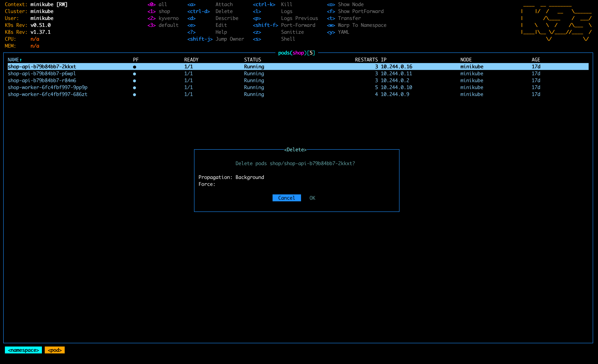

Через 12 секунд на его месте уже `…-9rn7m` с нулём рестартов и новым IP
`10.244.0.21`. Остальные поды не тронуты, их счётчики рестартов (3, 4, 5)
остались от перезагрузки ноутбука:

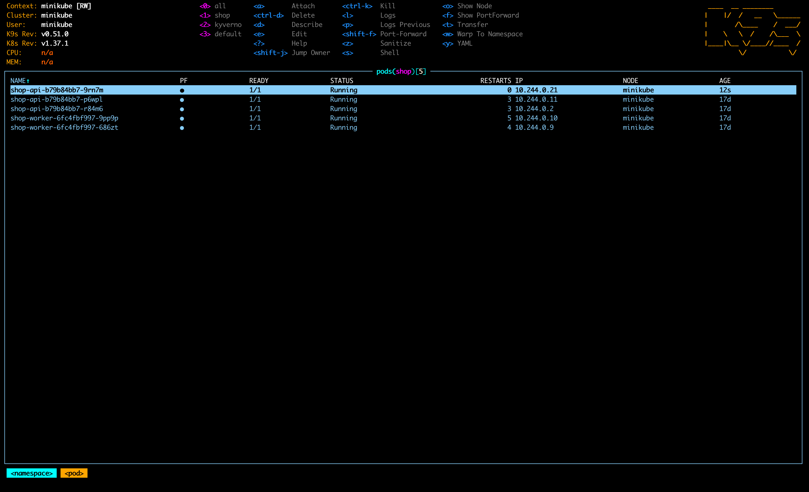

Тот же момент, пойманный раньше: удалённый под `…-r84m6` ещё в `Terminating`
(идёт `preStop`), а рядом уже работает замена `…-vr9fv`.

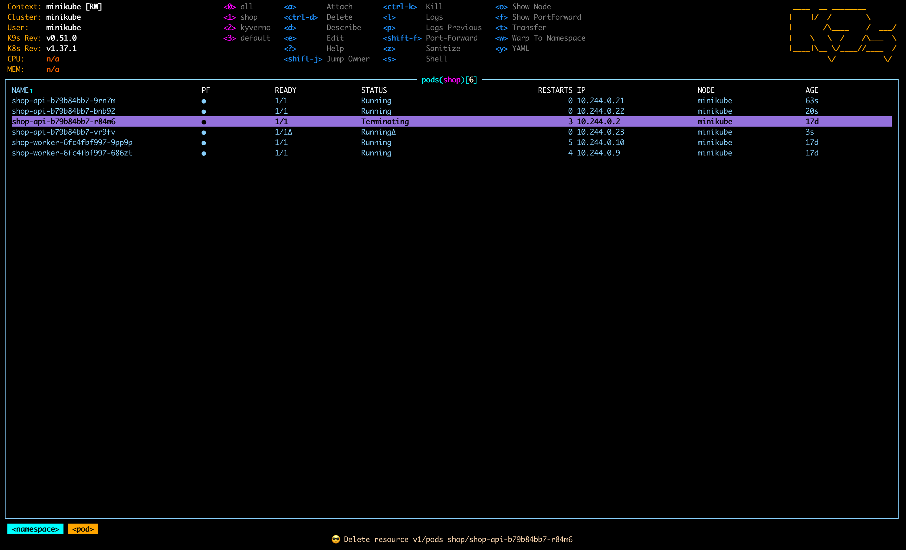

### Reconciliation: число реплик из values

`replicas` для `api` в `values.yaml` поменяли с 3 на 5, `helm upgrade`, и
обратно:

```bash
helm upgrade shop chart/shop -n shop --wait
kubectl -n shop get deploy shop-api
kubectl -n shop get pods -l app.kubernetes.io/name=api
```

```text
REVISION: 2
NAME       READY   UP-TO-DATE   AVAILABLE   AGE
shop-api   5/5     5            5           68s
    shop-api-7bc8c99447-6vsmw 1/1 Running 3s
    shop-api-7bc8c99447-6xqlk 1/1 Running 32s
    shop-api-7bc8c99447-ftrwx 1/1 Running 68s
    shop-api-7bc8c99447-mrt76 1/1 Running 3s
    shop-api-7bc8c99447-rhh6r 1/1 Running 68s
REVISION: 3
shop-api   3/3     3            3           77s
```

Число подов догнало values в обе стороны. Новые поды — из того же
ReplicaSet (`7bc8c99447`): шаблон пода не менялся, только число реплик.
Новый ReplicaSet появляется только при смене шаблона — это уже rolling
update.

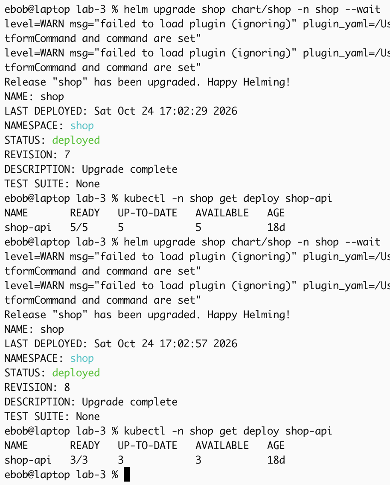

### Rolling update без единого провала

Чтобы проверить, что при обновлении ни один запрос не провалился, нужен
клиент, который долбит `/health` **через Service**, изнутри кластера. Через
`kubectl port-forward` нельзя: проброс к Service на деле цепляется к одному
поду и обрывается, когда rolling update его удаляет, — получились бы
провалы, которых у пользователей Service не было.

Второе ограничение — наши же ограждения: в `shop` под с `curl` не
запустить, его образ не из доверенного реестра. Клиент запущен в
`monitoring`, который исключён из политик, — так и поступают с утилитами
наблюдения:

```bash
kubectl -n monitoring run hammer --image=curlimages/curl:8.16.0 --restart=Never --command -- sh -c \
  'while true; do printf "%s " "$(date +%T)"; curl -s -m 2 -o /dev/null \
     -w "%{http_code} %header{x-app-version}\n" http://shop-api.shop.svc:8080/health || echo "000 conn-error"; sleep 0.1; done'
```

Десять запросов в секунду, каждый печатает код ответа и версию из
заголовка `X-App-Version`.

Версия 1.1.0 собрана той же командой (`make images VERSION=1.1.0`).

В `values.yaml` тег `api` поднят до `"1.1.0"`, `helm upgrade`, и раз в три
секунды — состояние ReplicaSet'ов:

```bash
helm upgrade shop chart/shop -n shop --wait
kubectl -n shop get rs -l app.kubernetes.io/name=api
```

```text
+ 3s  7bc8c99447 desired=3 ready=3 | b79b84bb7 desired=1 ready=0 |
+ 6s  7bc8c99447 desired=2 ready=2 | b79b84bb7 desired=2 ready=1 |
+ 9s  7bc8c99447 desired=1 ready=1 | b79b84bb7 desired=3 ready=2 |
+15s  7bc8c99447 desired=0 ready=0 | b79b84bb7 desired=3 ready=3 |
REVISION: 4
```

Новый ReplicaSet растёт 1 → 2 → 3, старый сжимается 3 → 2 → 1 → 0 — по
одному поду: каждый шаг ждал, пока новый под станет Ready. Что видел
клиент за эту минуту:

```bash
kubectl -n monitoring logs hammer --since=3m | awk '{print $2, $3}' | sort | uniq -c
```

```text
запросов за минуту обновления: 422
 105     200 1.0.0
 317     200 1.1.0
переход версий:
    01:05:00 200 1.0.0
    01:05:10 200 1.1.0
    01:05:11 200 1.0.0
    01:05:11 200 1.1.0
    01:05:12 200 1.0.0
    ...
    01:05:15 200 1.1.0
```

422 запроса, все — `200`, ни одного провала. С 01:05:10 по 01:05:15 обе
версии отвечали вперемешку: в эти секунды в Service были поды обоих
ReplicaSet'ов.

Повтор на следующей версии, 1.1.0 → 1.2.0 (ревизия 9): справа лог клиента —
обе версии вперемешку, все ответы `200`; слева — новый ReplicaSet
`ccd667d9f` 3/3, старые — 0.

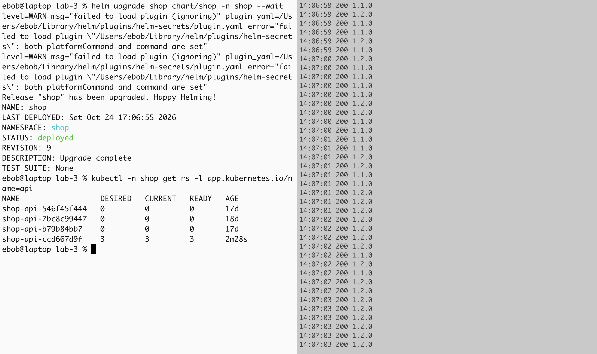

### Сломанная версия: rollout зависает

В `values.yaml` у `api` выставлено `healthFail: true`, `helm upgrade` —
нарочно без `--wait`, чтобы смотреть, как rollout зависает:

```bash
helm upgrade shop chart/shop -n shop
kubectl -n shop get pods -l app.kubernetes.io/name=api
kubectl -n shop get deploy shop-api -o jsonpath='{.status.conditions[?(@.type=="Progressing")]}'
```

```text
STATUS: deployed
REVISION: 5
=== +15s
    shop-api-546f45f444-h7hgc 0/1 Running restarts=0
    shop-api-b79b84bb7-2kkxt 1/1 Running restarts=0
    shop-api-b79b84bb7-p6wpl 1/1 Running restarts=0
    shop-api-b79b84bb7-r84m6 1/1 Running restarts=0
    Progressing=True reason=ReplicaSetUpdated
=== +90s
    shop-api-546f45f444-h7hgc 0/1 Running restarts=2
    ...
=== +140s
    shop-api-546f45f444-h7hgc 0/1 Running restarts=4
    shop-api-b79b84bb7-2kkxt 1/1 Running restarts=0
    shop-api-b79b84bb7-p6wpl 1/1 Running restarts=0
    shop-api-b79b84bb7-r84m6 1/1 Running restarts=0
    Progressing=False reason=ProgressDeadlineExceeded
```

- Создан ровно один новый под (`maxSurge: 1`). Он ни разу не стал Ready:
  readiness на `/health` получает 503. Liveness на том же `/health` четыре
  раза его перезапустила.
- Все три старых пода нетронуты: `maxUnavailable: 0` не позволяет убрать ни
  один, пока новый не готов.
- Через 120 секунд (`progressDeadlineSeconds`) Deployment признал, что
  rollout не идёт: `ProgressDeadlineExceeded`.
- `helm upgrade` без `--wait` при этом ответил `STATUS: deployed`: Helm
  отправил манифесты и о судьбе выкатки не знает. Статус релиза Helm без
  `--wait` — это «принято API-сервером», а не «работает».

Клиент всё это время получал только `200 1.1.0` — сервис отвечал старыми
подами.

Повтор на версии 1.2.0 (ревизия 10): новый под — в `CrashLoopBackOff` с
шестью рестартами, три старых работают; `rollout status` сообщает
`exceeded its progress deadline`; клиент получает только `200 1.2.0`.

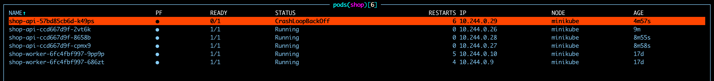

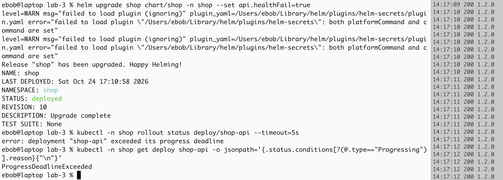

### Откат

```bash
helm rollback shop 4 -n shop --wait
helm history shop -n shop
kubectl -n shop get pods -l app.kubernetes.io/name=api
```

```text
Rollback was a success! Happy Helming!
REVISION  STATUS      DESCRIPTION
5         superseded  Upgrade complete
6         deployed    Rollback to 4
    shop-api-546f45f444-h7hgc 0/1 Terminating
    shop-api-b79b84bb7-2kkxt 1/1 Running
    shop-api-b79b84bb7-p6wpl 1/1 Running
    shop-api-b79b84bb7-r84m6 1/1 Running
Progressing=True reason=NewReplicaSetAvailable image=shop.local/api:1.1.0
```

- Откат в Helm — не отмена, а **новая ревизия** (6) с содержимым ревизии 4.
- Три рабочих пода даже не перезапускались: шаблон ревизии 4 совпадает с
  ReplicaSet `b79b84bb7`, который и так работал, и Deployment просто убрал
  сломанный под.
- Клиенты отката не заметили — все ответы `200`.

Повтор: `helm rollback shop -n shop --wait` без номера ревизии откатил на
предыдущую — ревизия 11 «Rollback to 9»; три рабочих пода возрастом 10 минут
не перезапускались.

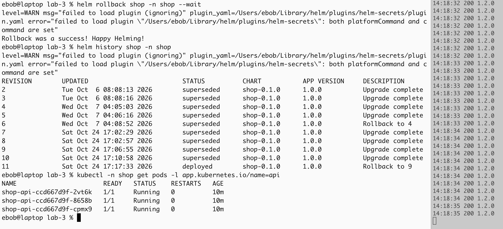

После отката в `values.yaml` возвращено `healthFail: false`, чтобы файл
совпадал с тем, что работает в кластере.

---

## Часть 3. Postgres через оператор

### Почему оператор, а не StatefulSet

StatefulSet умеет одно: держать N подов со стабильными именами и своими
дисками. Что внутри пода Postgres, он не знает — не отличит primary от
реплики, не сделает failover, не создаст пользователя. Оператор — это
контроллер со своим CRD (`Cluster`) и своим циклом reconcile, в который
зашита логика именно Postgres. Мы описываем, какая база нужна, а поды, PVC,
Service'ы и Secret'ы создаёт он.

Выбран CloudNativePG: он управляет подами напрямую, без StatefulSet, и
проект в CNCF.

### Установка оператора

```bash
helm repo add cnpg https://cloudnative-pg.github.io/charts
helm upgrade --install cnpg cnpg/cloudnative-pg --version 0.29.1 \
  -n cnpg-system --create-namespace --wait
```

### Cluster в чарте

[`templates/database.yaml`](chart/shop/templates/database.yaml) создаёт один
объект `Cluster` и только при `database.enabled=true`: без CRD оператора
API-сервер не знает, что такое `Cluster`, и `helm install` на чистом
кластере упал бы.

| Поле | Зачем |
|---|---|
| `bootstrap.initdb` | база `shop` с владельцем `shop`; оператор кладёт пароль и готовую строку подключения в Secret `shop-db-app`, ключ `uri` — его читает хелпер `shop.databaseEnv` и отдаёт `api`/`worker` как `DATABASE_URL` |
| `resources` | оператор ставит их всем своим контейнерам, включая init-контейнер `bootstrap-controller`, — иначе `require-resource-limits` отклонил бы под |
| `inheritedMetadata.labels` | метки самого `Cluster` на поды не переходят; то, что должно быть на подах (`app.kubernetes.io/name`, `part-of` для `require-labels`), задаётся здесь |

Образ `ghcr.io/cloudnative-pg/postgresql:18.6-system-trixie` — из
разрешённого реестра и с фиксированным тегом, так что `shop-db-1` прошёл
все шесть политик без исключений. Метки на нём — наши плюс операторские:

```text
app.kubernetes.io/name=postgres  app.kubernetes.io/part-of=shop
cnpg.io/cluster=shop-db  cnpg.io/instanceRole=primary  role=primary
```

### Приложение работает с базой

```bash
kubectl -n monitoring exec hammer -- curl -s -XPOST shop-api.shop:8080/order -d '{"item":"book","qty":2}'
sleep 3
kubectl -n monitoring exec hammer -- curl -s shop-api.shop:8080/orders
```

```text
{"id":2,"item":"book","qty":2,"status":"new","created_at":"2026-10-24T18:56:33.432718Z"}
[{"id":2,...,"status":"processed","processed_at":"2026-10-24T18:56:33.689722Z"},
 {"id":1,...,"status":"processed","processed_at":"2026-10-24T18:40:32.421863Z"}]
```

`api` записал заказ со статусом `new`, через четверть секунды `worker`
забрал его (`FOR UPDATE SKIP LOCKED`) и отметил `processed`.

### Удалённый под базы возвращается

```bash
kubectl -n shop delete pod shop-db-1          # в k9s: ctrl-d
kubectl -n shop get pods -l cnpg.io/cluster=shop-db -o wide -w
```

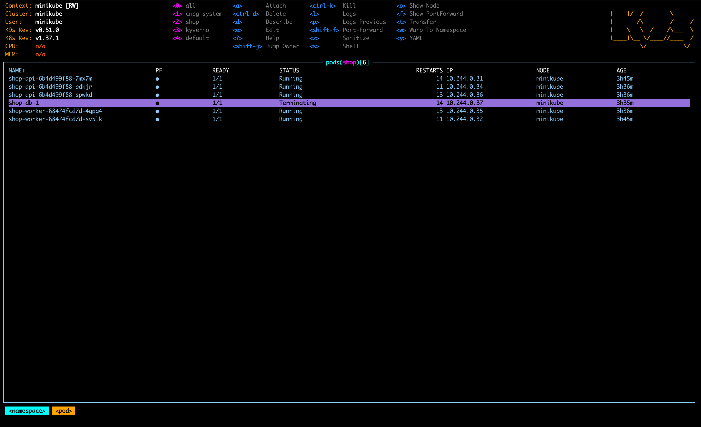

```text
shop-db-1   1/1   Running          14 (15m ago)   3h35m   10.244.0.37
shop-db-1   1/1   Terminating      14 (15m ago)   3h35m   10.244.0.37
shop-db-1   0/1   Terminating      14 (16m ago)   3h36m   10.244.0.37
shop-db-1   0/1   Completed        14 (18m ago)   3h38m   10.244.0.37
shop-db-1   0/1   Pending          0              0s      <none>
shop-db-1   0/1   Init:0/1         0              0s      10.244.0.38
shop-db-1   0/1   PodInitializing  0              2s      10.244.0.38
shop-db-1   0/1   Running          0              3s      10.244.0.38
shop-db-1   1/1   Running          0              11s     10.244.0.38
```

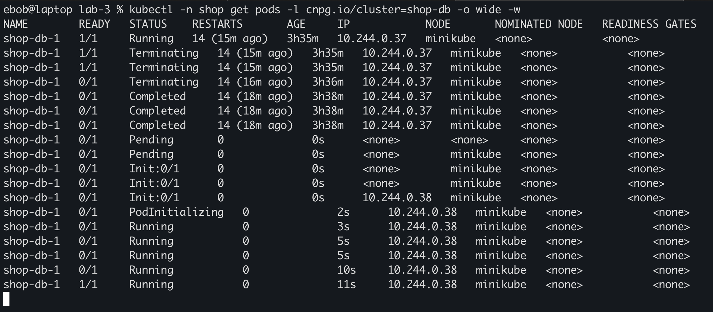

```bash
kubectl -n monitoring exec hammer -- curl -s shop-api.shop:8080/orders
kubectl -n shop get pvc
kubectl -n shop get sts
kubectl -n shop get pod shop-db-1 -o jsonpath='{.metadata.ownerReferences[*].kind}/{.metadata.ownerReferences[*].name}'
```

```text
[{"id":2,...,"status":"processed"},{"id":1,...,"status":"processed"}]
shop-db-1   Bound   pvc-3b355bcb-9ce5-43ee-9a81-b3788822b378   1Gi   RWO   standard   3h49m
No resources found in shop namespace.
Cluster/shop-db
```

Сравнение с подом `api` из Части 2:

| | под `api` | под базы |
|---|---|---|
| кто вернул | ReplicaSet (controller-manager) | оператор CNPG |
| имя | новое, случайное (`…-2kkxt` → `…-9rn7m`) | то же: `shop-db-1` |
| когда создаётся замена | сразу, параллельно со старым | только после того, как старый исчез |
| данные | нет состояния | тот же PVC `shop-db-1`, заказы на месте |
| завершение | 5 с (`preStop`) | около 3 минут |

StatefulSet'а в namespace нет: владелец пода — сам `Cluster`. Имя и PVC
выбрал оператор. Он знает, что экземпляр `shop-db-1` живёт на PVC
`shop-db-1`, и в логе прямо пишет, что делает:

```text
"msg":"Creating new Pod to reattach a PVC" ... "Cluster":{"name":"shop-db"}
```

Ждать исчезновения старого пода приходится по двум причинам: два пода с
одним именем в namespace невозможны, а PVC `ReadWriteOnce` нельзя отдать
двум Postgres сразу — два процесса на одном каталоге данных испортили бы
базу.

Почти три минуты в `Terminating` (события: `Stopping container postgres` —
и через 3 минуты 04 секунды `Scheduled` нового пода) совпадают с
`smartShutdownTimeout: 180` из `spec`. Оператор сначала делает smart
shutdown — Postgres перестаёт принимать новые соединения и ждёт, пока
отключатся текущие. А пулы `api` и `worker` держат соединения открытыми,
так что ждать пришлось до таймаута, после чего последовал fast shutdown.
Всё это время у единственного экземпляра нет замены: при `instances: 1`
удаление пода — простой базы, при двух экземплярах оператор сделал бы
switchover на реплику.

### spec и status

`kubectl -n shop get cluster shop-db -o yaml` (сокращено):

```yaml
spec:                       # чего хотим — пишем мы (Helm) и дефолты webhook'а
  instances: 1
  imageName: ghcr.io/cloudnative-pg/postgresql:18.6-system-trixie
  bootstrap:
    initdb: { database: shop, owner: shop, encoding: UTF8 }
  storage: { size: 1Gi, resizeInUseVolumes: true }
  resources: { limits: { cpu: 500m, memory: 512Mi }, requests: { cpu: 100m, memory: 256Mi } }
  smartShutdownTimeout: 180
  postgresql:
    parameters: { wal_level: logical, archive_mode: "on", ... }
status:                     # что есть на самом деле — пишет только оператор
  phase: Cluster in healthy state
  currentPrimary: shop-db-1
  targetPrimary: shop-db-1
  instances: 1
  readyInstances: 1
  instancesReportedState:
    shop-db-1: { ip: 10.244.0.38, isPrimary: true, timeLineID: 1 }
  healthyPVC: [shop-db-1]
  writeService: shop-db-rw
  readService: shop-db-r
  conditions:
  - { type: Ready, status: "True", reason: ClusterIsReady,
      lastTransitionTime: "2026-10-24T19:04:23Z" }
  certificates:
    expirations: { shop-db-server: 2027-01-22 15:10:41 +0000 UTC, ... }
```

### Оператор и `controller-manager`

Механизм один и тот же — reconcile loop:
следить за объектами, сравнивать желаемое (`spec`) с фактическим,
действовать и записывать увиденное в `status`.
Отличий два.

Чем управляют:
`controller-manager` — набор универсальных контроллеров для встроенных
ресурсов, которым всё равно, что внутри пода; оператор приносит свой CRD и
знания предметной области (primary, реплики, WAL, failover, smart shutdown).

Где живут: `controller-manager` — часть control plane, статический под на
master-ноде; оператор — обычное приложение, ставится Helm'ом и падает, как
любое приложение.

---

## Часть 4. Падение control plane

### Как остановить etcd

В minikube etcd — статический под: его запускает не планировщик, а kubelet
прямо из файла `/etc/kubernetes/manifests/etcd.yaml`, следя за каталогом.
Убрать файл — kubelet остановит под, вернуть — запустит. `kubectl delete`
здесь не помог бы: под в API — лишь зеркало статического, а без etcd не
работает и сам API.

Наблюдать нужно тоже мимо API: `kubectl exec` идёт через apiserver и во
время аварии не работает. Поэтому клиент крутится на самой ноде через
`minikube ssh` (это `docker exec` в контейнер minikube) и ходит на ClusterIP
Service'а `shop-api` — правила kube-proxy действуют и на ноде.

```bash
# терминал 1: клиент, которому не нужен API
minikube ssh -- 'while true; do echo "$(date +%T) $(curl -s -m 2 -o /dev/null -w %{http_code} http://10.111.156.147:8080/orders)"; sleep 1; done'
```

### Авария

```bash
minikube ssh -- 'sudo mv /etc/kubernetes/manifests/etcd.yaml /tmp/'
minikube ssh -- 'sudo crictl ps --name "etcd|kube-apiserver"'
```

```text
CONTAINER       CREATED          STATE     NAME             ATTEMPT
2260231d2786c   16 seconds ago   Running   kube-apiserver   39
```

etcd исчез, а apiserver за это время перезапустился пять раз (попытка 34 →
39): без etcd он не может стартовать, падает, и kubelet поднимает его снова.

Управлять кластером нельзя:

```bash
kubectl get pods -A
helm upgrade shop chart/shop -n shop --set database.enabled=true --set worker.replicas=3
```

```text
Unable to connect to the server: EOF
Error: UPGRADE FAILED: kubernetes cluster unreachable: Get "https://127.0.0.1:63112/version": EOF
```

Ошибка мгновенная, а не таймаут: порт `127.0.0.1:63112` пробрасывает Docker,
он принимает TCP-соединение и тут же закрывает его — apiserver за ним то
лежит, то стартует.

А приложение работает, и не только на чтение. Запись — тоже мимо API, с
ноды:

```bash
minikube ssh -- 'curl -s -XPOST http://10.111.156.147:8080/order -d "{\"item\":\"pen\",\"qty\":1}"'
minikube ssh -- 'curl -s http://10.111.156.147:8080/orders'
```

```text
{"id":3,"item":"pen","qty":1,"status":"new","created_at":"2026-10-24T19:55:38.722433Z"}
[{"id":3,"item":"pen","qty":1,"status":"processed","processed_at":"2026-10-24T19:55:39.804633Z"}, ...]
```

`api` записал заказ в Postgres, `worker` через секунду его обработал.
Терминал 1 всё время аварии показывал только `200`.

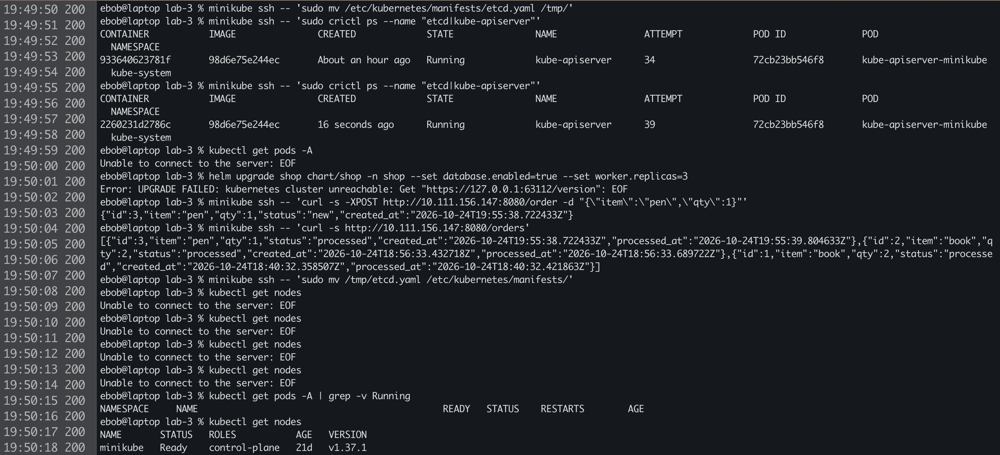

Почему так. Data plane держит у себя всё, что нужно для работы, и в API
для этого не ходит:

- контейнеры запущены containerd, kubelet следит за ними по локальному
  состоянию и сам гоняет пробы;
- маршрут ClusterIP → под уже записан kube-proxy в правила ядра ноды;
- `api` ходит в базу по `shop-db-rw` — DNS-запись CoreDNS держит в памяти;
- соединения `api`/`worker` с Postgres — обычные TCP-сессии, о Kubernetes
  они ничего не знают.

Рестартов у подов `shop` за аварию не прибавилось ни одного.

### Возврат

```bash
minikube ssh -- 'sudo mv /tmp/etcd.yaml /etc/kubernetes/manifests/'
kubectl get nodes          # несколько раз EOF, потом Ready
kubectl get pods -A | grep -v Running
```

```text
minikube   Ready    control-plane   21d   v1.37.1
cnpg-system   cnpg-cloudnative-pg-7b5f5d7b65-8xrc2     0/1   CrashLoopBackOff   43 (2m9s ago)
monitoring    kps-kube-state-metrics-747b7b996-rr4qc   0/1   CrashLoopBackOff   54 (75s ago)
```

Кластер вернулся, но не весь. Пострадали как раз те, кому API нужен для
работы: оператор CNPG и kube-state-metrics при старте спрашивают у
apiserver, какие ресурсы существуют, не получают ответа и выходят:

```text
cnpg:  "unable to start manager" ... Get "https://10.96.0.1:443/api": connect: connection refused
ksm:   "Failed to run kube-state-metrics" ... Get "https://10.96.0.1:443/version": connect: connection refused
```

Kyverno тоже перезапустился (admission и cleanup — по разу). Проблема не в
самом падении, а в `CrashLoopBackOff`: за время аварии пауза между
попытками выросла до минут, и после возврата API они ещё ждали своей
очереди.

И снова отказ webhook'а — ревизия 15:

```bash
helm upgrade shop chart/shop -n shop --set database.enabled=true --wait
```

```text
Error: UPGRADE FAILED: ... failed calling webhook "mcluster.cnpg.io": ...
dial tcp 10.99.116.79:443: connect: connection refused
```

Кластер «поднялся», но управлять базой нельзя, пока не поднимется оператор.
Через пару минут backoff отпустил оба пода, и та же команда прошла:

```text
REVISION: 16
STATUS: deployed
```

---

## Часть 5. Мониторинг

### Как Prometheus узнаёт о магазине

Конфиг scrape мы не пишем. Prometheus в лабе 2 управляется
prometheus-operator — ещё одним оператором со своими CRD. Он следит за
`ServiceMonitor`/`PodMonitor`/`PrometheusRule` и сам переписывает конфиг и
файлы правил Prometheus. Селекторы у нашего Prometheus пустые, поэтому он
берёт эти объекты из любого namespace.

[`templates/monitoring.yaml`](chart/shop/templates/monitoring.yaml):

| Объект | Что выбирает | Почему так |
|---|---|---|
| `ServiceMonitor shop` | Service'ы `api` и `worker` (`component In [api, worker]`) | Service — только способ найти поды: Prometheus раскрывает его через EndpointSlice и собирает метрики с каждого пода отдельно, а не через балансировку. Service'ы оператора `shop-db-*` тоже несут `part-of: shop`, но `/metrics` на порту `http` у них нет |
| `PodMonitor shop-db` | поды `cnpg.io/cluster=shop-db` | экспортер Postgres живёт в каждом поде экземпляра на порту `metrics` (9187), Service с этим портом оператор не создаёт |
| `PrometheusRule shop` | — | четыре алерта и два recording rule |

Заодно `database.enabled` стал `true` по умолчанию. Раньше база
включалась флагом `--set database.enabled=true`, и `helm upgrade` без него
удалил бы `Cluster`, а оператор вслед за ним — PVC с заказами. Значение по
умолчанию должно быть безопасным.

```bash
helm upgrade shop chart/shop -n shop --wait
kubectl -n monitoring port-forward svc/kps-prometheus 9090
```

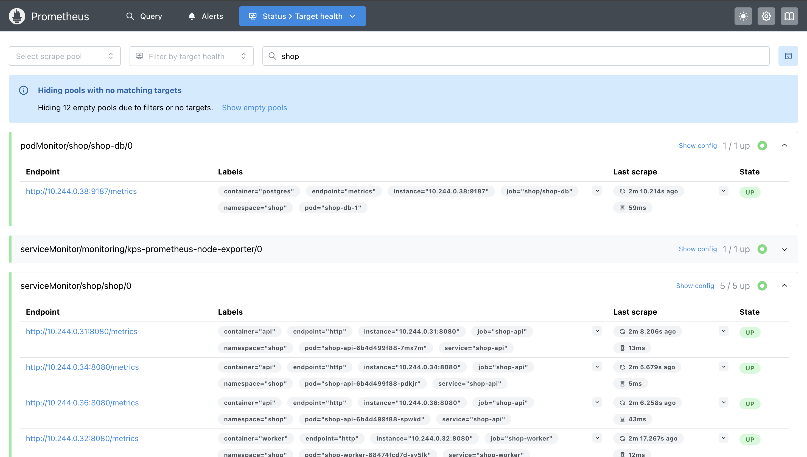

`shop-db` 1/1 и `shop` 5/5 в `UP`, у каждого пода своя цель. Проверка в
Query:

```text
sum by (pod) (rate(http_requests_total{namespace="shop"}[1m]))
{pod="shop-api-6b4d499f88-7mx7m"}  3.80
{pod="shop-api-6b4d499f88-spwkd"}  4.07
{pod="shop-api-6b4d499f88-pdkjr"}  3.87

shop_orders_pending{pod="shop-worker-68474fcd7d-sv5lk"}  0
shop_orders_pending{pod="shop-worker-68474fcd7d-4qpg4"}  0

cnpg_collector_up{pod="shop-db-1"}  1
```

### Алерты

| Алерт | Ловит | Действие | `for` | severity |
|---|---|---|---|---|
| `ShopApiErrorRatioHigh` | больше 5% ответов `api` — 5xx | смотреть, что сломалось за `api` | 2m | critical |
| `ShopWorkerStalled` | нет успешного прохода больше 60 с, или нет ни одного воркера | искать причину, масштабирование не поможет | 1m | critical |
| `ShopOrderBacklogGrowing` | очередь ни разу за 10 минут не опускалась ниже 50 | добавить воркеров | 5m | warning |
| `ShopDatabaseDiskFillingUp` | по тренду 6 часов том кончится за 4 часа | увеличить `database.storage` или найти, кто держит WAL | 15m | warning |
| `ShopDatabaseDown` | Postgres не принимает соединения | поднимать базу; симптомы выше на это время глушатся | 1m | critical |

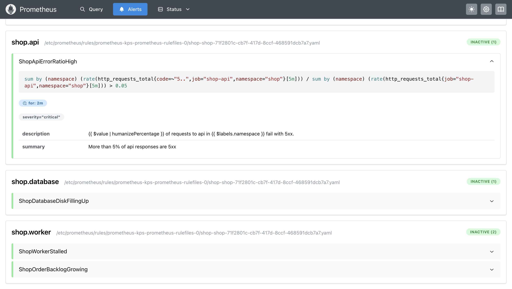

### Провокация: база выключена

Удаление пода базы даёт пару минут — оператор вернёт его. Нужно дольше
`for:`, поэтому база выключена декларативной гибернацией CNPG: оператор
останавливает поды экземпляров, но сохраняет PVC. Тот же reconcile loop —
меняем желаемое состояние, оператор приводит к нему реальность.

```bash
# терминал 1 — трафик на /orders (он ходит в базу, /health — нет)
minikube ssh -- 'while true; do echo "$(date +%T) $(curl -s -m 2 -o /dev/null -w %{http_code} http://10.111.156.147:8080/orders)"; sleep 1; done'

# терминал 2
kubectl -n shop annotate cluster shop-db cnpg.io/hibernation=on
```

```text
11:22:38 503
11:22:40 503
11:22:42 000
11:22:45 503
11:22:46 503
11:22:47 000
```

`503 database not ready` — так `api` и задуман: без базы он жив (liveness
не трогает базу), но честно отвечает, что заказы недоступны. `000` —
запрос не уложился в двухсекундный таймаут `curl`: часть запросов при
недоступной базе ещё и висит.

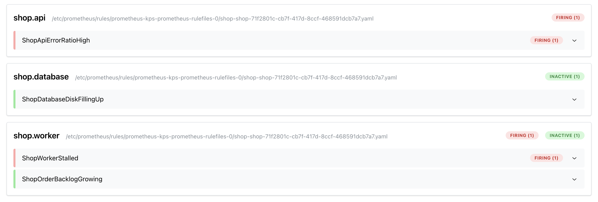

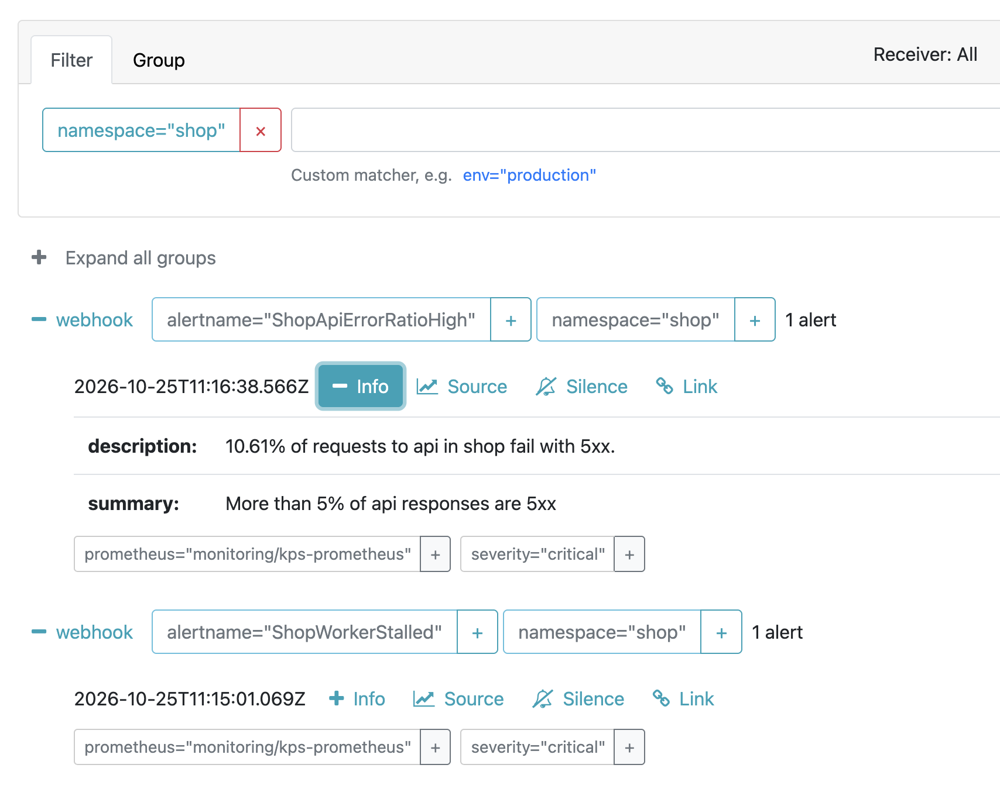

Что пришло в `alert-receiver` из лабы 2:

```text
firing    ShopWorkerStalled      startsAt 11:15:01
firing    ShopApiErrorRatioHigh  startsAt 11:16:38   "8.934% of requests to api in shop fail with 5xx."
resolved  ShopWorkerStalled      endsAt   11:24:01
resolved  ShopApiErrorRatioHigh  endsAt   11:26:38
```

```bash
kubectl -n shop annotate cluster shop-db cnpg.io/hibernation=off --overwrite
```

### Дашборд

Grafana запускает sidecar, который следит за ConfigMap'ами с
меткой `grafana_dashboard: "1"` во всех namespace и загружает их как
дашборды. Поэтому дашборд лежит в чарте —
[`dashboards/shop.json`](chart/shop/dashboards/shop.json) и
[`templates/dashboard.yaml`](chart/shop/templates/dashboard.yaml) — и
версионируется вместе с метриками и алертами, которые показывает. Панели с
порогами используют те же выражения, что и алерты, и рисуют порог красной
линией.

`.Files.Get` не рендерит шаблоны, поэтому легенды Grafana вида
`{{code}}` доходят до неё нетронутыми. А вот в комментарии шаблона такой
текст Helm честно попытался выполнить — `function "code" not defined`.

Авария повторена под нагрузкой, чтобы на графиках были все три участка —
до, во время и после. Трафик с ноды: каждую секунду `GET /orders` и
`POST /order`.

```bash
kubectl -n shop annotate cluster shop-db cnpg.io/hibernation=on --overwrite
# 5–6 минут
kubectl -n shop annotate cluster shop-db cnpg.io/hibernation=off --overwrite
```

`--overwrite` понадобился потому, что после прошлой аварии аннотация
осталась со значением `off`. Чище было бы снимать её совсем:
`kubectl annotate … cnpg.io/hibernation-`.

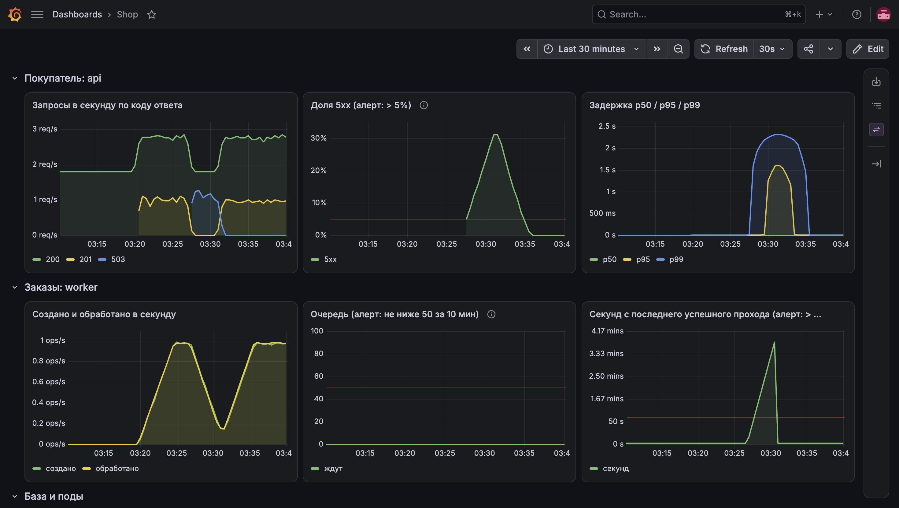

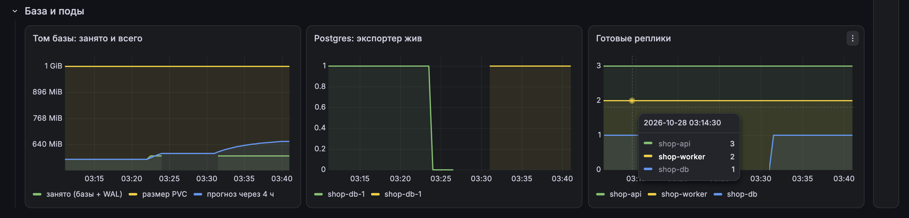

Что видно и чем это отличается от ожиданий:

- **Сначала упал экспортер, а не магазин.** `cnpg_collector_up` ушёл в 0
  около 03:24, а `503` у `api` начались только около 03:27. Это smart
  shutdown: Postgres перестал принимать **новые** соединения (экспортер
  подключается заново на каждый сбор), но три минуты дорабатывал
  **открытые** — а пулы `api` и `worker` держат свои соединения. Потом
  `smartShutdownTimeout: 180` истёк, и база закрылась совсем.
- **Доля 5xx — 31%, хотя `/orders` отказывал полностью.** На панели
  запросов видно почему: около 2 запросов в секунду с кодом `200` не
  пропали во время аварии. Это пробы kubelet на `/health` (3 пода ×
  readiness раз в 2 с плюс liveness) — они в базу не ходят и разбавляют
  знаменатель.
- **Задержка тоже симптом.** p99 поднялся до 2.3 с, p95 до 1.6 с: часть
  запросов при недоступной базе не падает сразу, а ждёт соединения из
  пула. Это и были строки `000` в прошлый раз — `curl` не дождался ответа
  за 2 секунды.
- **Очередь осталась на нуле**, как и ожидалось: без базы `api` не может
  и создать заказ, так что копиться нечему. `ShopOrderBacklogGrowing` при
  падении базы не срабатывает в принципе — он про другую беду.
- **Секунды с последнего прохода** росли линейно до 4 минут и упали в
  ноль сразу после возврата базы, а доля 5xx спадала ещё минут пять —
  старые `503` оставались в окне `rate(…[5m])`.
- **Создано / обработано** не упали в ноль, а провалились до ~0.15 —
  `rate` за 5 минут сглаживает короткий провал.
- **Экспортер вернулся другой линией** (другой цвет): у нового пода новый
  IP, значит новая метка `instance` — для Prometheus это новый ряд.

### Одна авария — одно уведомление

На падение базы пришло два critical-уведомления, и ни одно не говорило
«база лежит». База — причина, а 5xx у `api` и вставшие воркеры — её
симптомы: оба ходят в базу. Поэтому добавлены отдельный алерт на причину
и правило подавления симптомов.

**`ShopDatabaseDown`** (critical, `for: 1m`):

```promql
max by (namespace) (cnpg_collector_up{namespace="shop", cluster="shop-db"}) == 0
  or
absent(cnpg_collector_up{namespace="shop", cluster="shop-db"})
```

Выбор подсказал дашборд: экспортер подключается к Postgres заново на
каждый сбор и показал 0 первым, ещё в начале smart shutdown — на минуты
раньше, чем рвутся соединения пулов приложения. `absent` нужен для случая,
когда пода нет вовсе (гибернация). Срабатывать раньше симптомов — не
украшение, а требование: inhibition глушит только алерты, пришедшие, пока
источник уже горит. Если симптом успеет первым, его уведомление уйдёт.

**Inhibition.** Перед рассылкой Alertmanager проверяет `inhibit_rules`:
пока горит алерт, подходящий под source, алерты, подходящие под target, не
рассылаются — если у них совпадают метки из `equal`. Подавленный алерт не
удаляется: он виден в UI с пометкой *inhibited* и уйдёт, если причина
погаснет, а он продолжит гореть.

Правило живёт в чарте как `AlertmanagerConfig`
([`templates/monitoring.yaml`](chart/shop/templates/monitoring.yaml)) —
prometheus-operator подхватывает его так же, как `PrometheusRule`.
Итоговый конфиг Alertmanager после выкатки:

```bash
kubectl -n monitoring get secret alertmanager-kps-alertmanager-generated \
  -o jsonpath='{.data.alertmanager\.yaml\.gz}' | base64 -d | gunzip
```

```yaml
inhibit_rules:
- source_matchers: [severity = "critical"]      # было в лабе 2
  target_matchers: [severity = "warning"]
  equal: [alertname, namespace]
- source_matchers:                               # наше
  - alertname="ShopDatabaseDown"
  - namespace="shop"
  target_matchers:
  - alertname=~"ShopApiErrorRatioHigh|ShopWorkerStalled"
  - namespace="shop"
  equal: [namespace]
```
