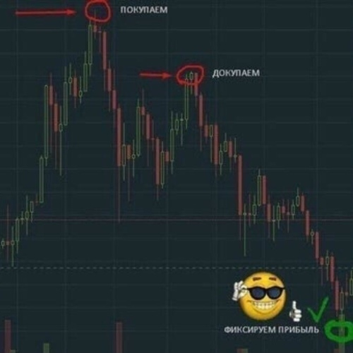
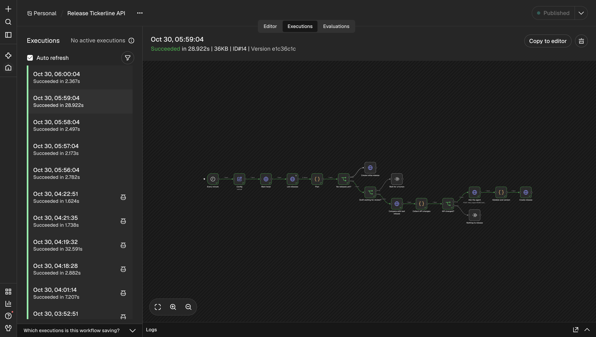
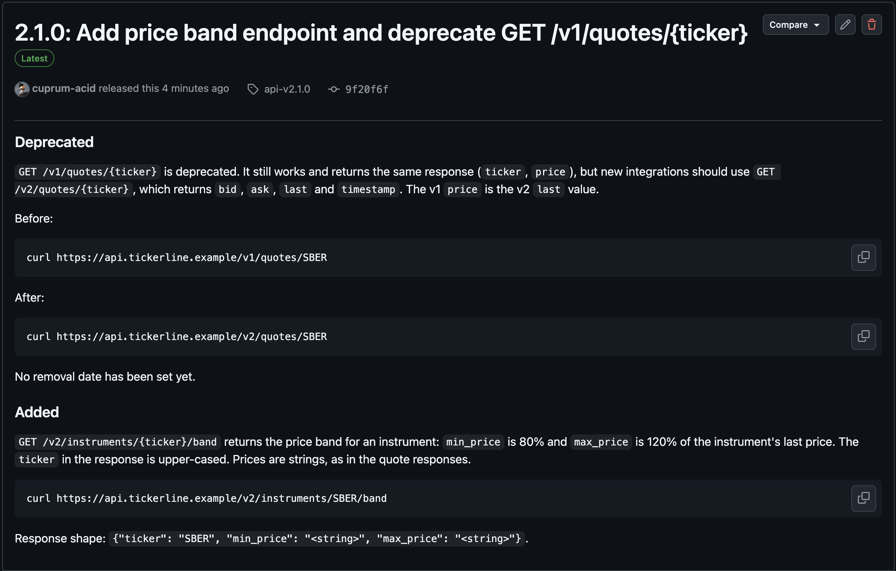
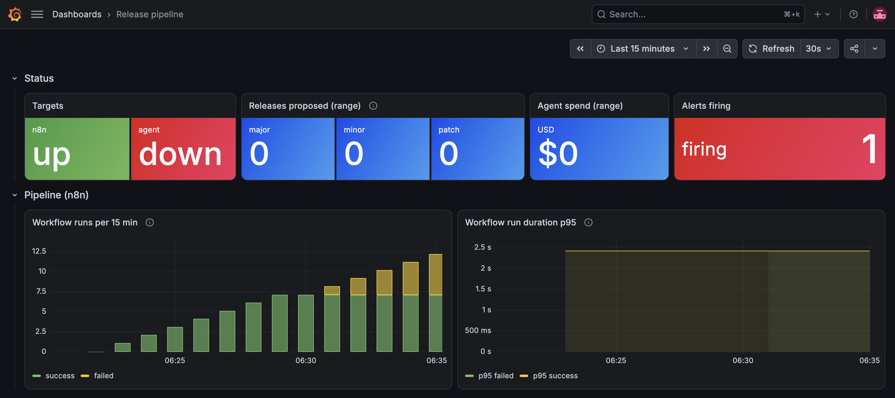
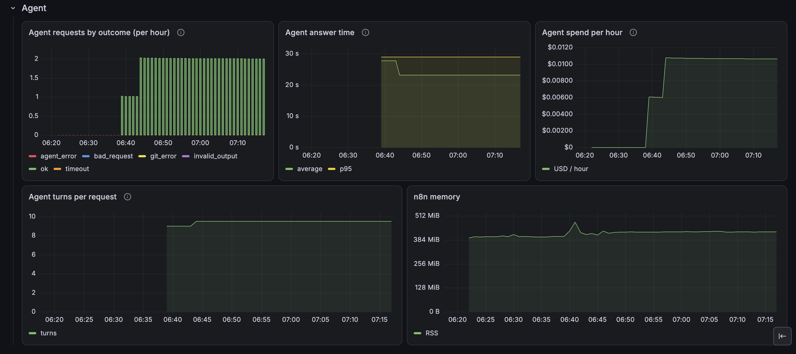
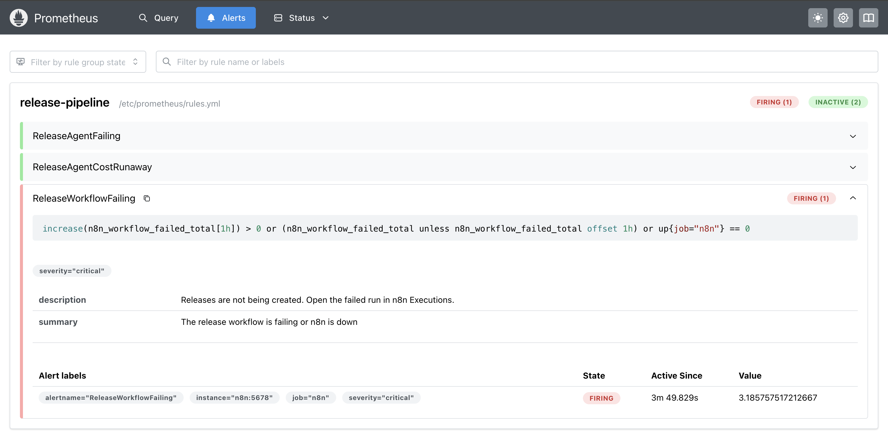
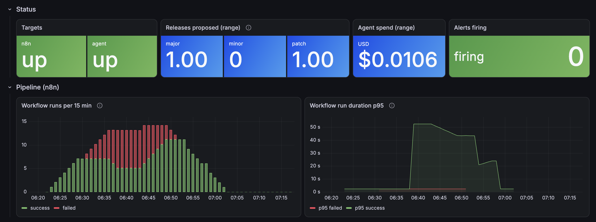

# Лаба 8 — агент, который выпускает релизы

## Часть 1. Кейс

### Компания и люди

***Самый настоящий андеграунд*** (The Real Underground) — B2B SaaS с публичным REST API для работы с ценными бумагами: котировки, справочник инструментов, портфели и выставление заявок. Клиенты — брокеры, робоэдвайзеры и финтех-стартапы. Их разработчики (интеграторы) встраивают API в свои продукты и обновляют интеграцию по нашим release notes. Те же заметки читают внутренние команды: саппорт интеграций, мобильное приложение, аналитики.



Бэкенд мержит в `main` несколько раз в день. Release notes пишут разработчики или тимлид в конце спринта: по памяти, вспоминая, что было за две недели. Важное регулярно выпадает. Версию тоже ставят на глаз, поэтому номер релиза ничего не говорит клиенту о том, сломается ли у него интеграция.

### Что болит

За последний квартал было три случая.

1. В ответе `/v2/orders` поле `price` переименовали в `limit_price`. Коммит назывался `refactor order serializer`, в заметки он не попал, релиз вышел как patch. Клиент узнал о переименовании из ночного инцидента: его робот перестал выставлять заявки. Утром пришла эскалация.
2. В API появился новый эндпоинт, но в заметках его не описали. Через месяц никто, кроме автора, не мог сказать, что он делает и можно ли на него опираться.
3. Старый метод пометили как deprecated в коде, а клиентов не предупредили. Сроков отключения никто не знал.

Общая причина: заметки пишут по сообщениям коммитов и по памяти, а истина лежит в diff публичного контракта (`openapi.yaml`). Сверять контракт руками на каждый релиз никто не будет.

### Кому помогает

Прежде всего команде бэкенда: им больше не нужно писать заметки и выбирать версию. Опосредованно — всем, кто читает релизы: интеграторам клиентов, саппорту и соседним командам. Для них номер версии снова означает то, что обещает semver.

### Что делает автоматизация

```text
push в main (n8n раз в минуту сверяет main с последним релизом)
  -> n8n: последний релиз, коммиты с него, менялся ли API           [без AI]
  -> агент: коммиты, PR, diff openapi.yaml -> по skill'у решает
            bump (major/minor/patch), пишет title и notes -> JSON  [AI]
  -> n8n: проверка JSON, страховка BREAKING CHANGE, новая версия    [без AI]
  -> n8n: тег и GitHub Release (major - черновиком, ждёт человека)  [без AI]
```

Агент только предлагает решение, а релиз создаёт n8n. Причина в том, что публикация релиза необратима и её сразу видят все клиенты. Детерминированный шаг сначала проверяет ответ агента: JSON соответствует схеме, bump — одно из трёх значений, явный `BREAKING CHANGE` в коммите не превратился в patch. Арифметика версии (последний тег плюс bump) тоже детерминированная, модели она не нужна. Агенту хватает прав только на чтение репозитория, писать в него может лишь n8n.

Результат — GitHub Release с правильным номером версии и заметками, сгруппированными для читателя: Breaking changes с инструкцией по миграции, Added, Deprecated со сроками, Fixed.

## Часть 2. Как устроен workflow


### MCP-серверы

| Сервер | Что даёт агенту |
|---|---|
| Git MCP (`mcp-server-git`) на локальном клоне | diff и содержимое файлов на любой ревизии, без GitHub API и его rate limit |
| GitHub MCP (`github/github-mcp-server`) | pull request'ы: описание, обсуждение, то есть намерение автора |
| Filesystem MCP (`@modelcontextprotocol/server-filesystem`) | исходный код в рабочем дереве, чтобы объяснить, что делает новая функциональность |

### Toolkit агента

Каждый сервер умеет больше, чем нужно, в том числе писать. Агенту разрешены только эти четыре инструмента:

| Инструмент | Что делает | Вход |
|---|---|---|
| `mcp__git__git_diff` | diff между ревизией и рабочим деревом клона: что вообще изменилось с прошлого релиза | `repo_path`, `target` (последний тег, например `api-v1.0.0`), `context_lines` |
| `mcp__git__git_show` | содержимое файла на ревизии, если передать `<ref>:<path>`. Так агент читает `openapi.yaml` на прошлом теге и сравнивает контракт до и после | `repo_path`, `revision` (например `api-v1.0.0:lab-8/release-notes-agent/api/openapi.yaml`) |
| `mcp__github__pull_request_read` | данные PR: описание, обсуждение, список файлов. Агент сверяет заявленное автором с тем, что видно в контракте | `owner`, `repo`, `pullNumber`, `method` (`get`, `get_comments`, `get_files`) |
| `mcp__filesystem__read_text_file` | текущий файл из клона. Нужен, когда в контракте появился эндпоинт без описания и надо понять по коду, что он делает | `path`, `head` / `tail` (необязательно) |

### Skill агента

Know-how агента лежит в [`agent/.claude/skills/release-notes/SKILL.md`](agent/.claude/skills/release-notes/SKILL.md). Claude Code сам подхватывает skills из `.claude/skills` рабочей директории. Главное правило skill'а: истина — это diff контракта, а не сообщения коммитов. Поэтому агент идёт от слов к фактам: сначала читает, что заявил автор в PR, затем смотрит общий diff, затем сравнивает `openapi.yaml` на прошлом теге и сейчас, и в конце читает код. Код нужен потому, что поведение может сломаться и без изменения спецификации: валидация стала строже, поменялось значение по умолчанию.

Правила bump опираются на один вопрос: сломается ли интеграция, которую не трогали и которая написана по документированному контракту? Поэтому новое необязательное поле в ответе — это minor (клиент его просто проигнорирует), а новое обязательное поле в запросе — major (старый клиент его не пришлёт и получит 422). Deprecation — это minor: метод ещё работает, но обязан попасть в заметки вместе со сроком отключения или с прямым указанием, что срока нет. Исправление, которое приводит поведение к обещанному контрактом, — это patch, даже если значения стали другими. Последнее правило появилось после прогона, описанного в Части 3. При сомнении, которое не разрешили правила, агент выбирает уровень выше. Ложный major стоит клиенту пяти минут чтения, ложный patch — ночного инцидента.

Заметки пишутся для интеграторов, без внутренних деталей. Для каждого breaking change даётся пример `curl` до и после.

### Workflow в n8n

Экспорт лежит в [`workflows/release-the-real-underground-api.json`](workflows/release-the-real-underground-api.json). AI-шаг в нём один — `Ask the agent`, всё остальное обычная логика и вызовы GitHub API.

```text
Every minute -> Config -> Main head -> List releases -> Plan
  -> No releases yet?          -true->  Create initial release (1.0.0)
  -> Draft waiting for review? -true->  Wait for a human
  -> Compare with last release -> Collect API changes
  -> API changed?              -false-> Nothing to release
  -> Ask the agent [AI] -> Validate and version -> Create release
```

| Нода | Что делает и зачем |
|---|---|
| `Every minute` | Триггер. Вебхук GitHub до n8n на localhost не дойдёт, а туннель выставил бы в интернет n8n с токеном на запись. Опрос раз в минуту даёт ту же логику без входящих подключений |
| `Main head` | Точный sha `main` на момент запуска. Он же уходит в `target_commitish`: если во время работы агента в `main` прилетит ещё коммит, тег всё равно встанет на то, что агент описал |
| `List releases`, `Plan` | Последний релиз по semver (как числа: `1.10.0 > 1.9.0`). Берём релизы, а не теги: у черновика тега ещё нет, и по тегам n8n каждую минуту открывал бы тот же черновик заново |
| `Collect API changes` | Релиз нужен, только если менялось что-то в `api/`. В репозитории лежат и другие лабы, пуш отчёта не должен выпускать версию |
| `Ask the agent` | `POST http://agent:8080/release`: owner, repo, sha, последний тег, коммиты. Обёртка переводит клон на sha и запускает `claude -p` |
| `Validate and version` | Ответ агента проверяется по схеме. Если в коммитах есть `BREAKING CHANGE` или `feat!:`, bump поднимается до major, что бы ни сказал агент, — и никогда не понижается: маркер ставит человек, и его забывают. Версию считает код. Major уходит черновиком |
| `Create release` | Тег и релиз одним запросом: GitHub создаёт тег сам, если его ещё нет |

### Защита от собственного агента

Описание PR пишет кто угодно, и для модели этот текст лежит рядом с инструкциями: попросить в нём «заодно запушь в main» — это prompt injection. Просьба в промпте не пользоваться пишущими инструментами здесь ничего не гарантирует, поэтому ограничения стоят там, где их проверяет не модель:

1. `--tools Skill` и `--allowedTools` с четырьмя инструментами: Claude Code отклоняет любой другой вызов до того, как он случится. Встроенных `Bash`, `Read`, `WebFetch` у агента нет совсем.
2. GitHub MCP запущен с `--read-only --toolsets pull_requests`: пишущие инструменты даже не регистрируются.
3. Токен агента — fine-grained, только Contents: read и Pull requests: read. Даже если первые два слоя сломаются, GitHub откажет в записи. Побочный эффект виден на практике: черновики релизов этим токеном не прочитать, GitHub показывает их только тем, у кого есть запись.
4. Права на запись есть только у n8n, и n8n проверяет ответ агента, прежде чем что-то создать.

## Часть 3. Запуск

### Что где лежит

| Путь | Что это |
|---|---|
| `api/` | мок-API The Real Underground на FastAPI и его контракт `openapi.yaml`, который генерирует `export_openapi.py` |
| `agent/` | образ агента: Claude Code 2.1.312, три MCP-сервера, skill и HTTP-обёртка `server.py` с метриками |
| `workflows/` | экспорт workflow n8n |
| `monitoring/` | конфиг Prometheus, правила алертов, provisioning Grafana и дашборд |
| `compose.yaml` | всё вместе: `agent`, `n8n`, `prometheus`, `grafana` |

Модель — Claude Haiku через подписку Claude: токен выпущен `claude setup-token`. Прогон одного релиза стоит меньше цента.

### Секреты

Ни одного секрета в репозитории, в `.env` или в `docker inspect`. Все токены лежат в Keychain, compose берёт их из переменных окружения в момент `up` и монтирует файлами в `/run/secrets`:

| Keychain | Что это | Кто читает |
|---|---|---|
| `lab8-claude-token` | токен Claude Code | агент, только процесс `claude` |
| `lab8-github-ro` | GitHub, только чтение | агент, GitHub MCP |
| `lab8-n8n-key` | ключ, которым n8n шифрует credentials | n8n через `N8N_ENCRYPTION_KEY_FILE` |
| `lab8-grafana-admin` | пароль админа Grafana | Grafana через `GF_SECURITY_ADMIN_PASSWORD__FILE` |

Токен GitHub с правом записи лежит только в Credentials n8n, зашифрованный ключом из Keychain. Если volume n8n утечёт, без ключа токен из него не достать. Если ключ потерять, n8n не расшифрует сохранённые credentials, и токен придётся вводить заново.

```bash
security add-generic-password -a "$USER" -s lab8-claude-token -w    # value: claude setup-token
security add-generic-password -a "$USER" -s lab8-github-ro -w       # fine-grained PAT, read-only
security add-generic-password -a "$USER" -s lab8-n8n-key -w "$(openssl rand -hex 32)"
security add-generic-password -a "$USER" -s lab8-grafana-admin -w "$(openssl rand -hex 16)"
```

### Подъём

```bash
cd lab-8/release-notes-agent
export CLAUDE_TOKEN=$(security find-generic-password -s lab8-claude-token -w)
export GITHUB_TOKEN_RO=$(security find-generic-password -s lab8-github-ro -w)
export N8N_KEY=$(security find-generic-password -s lab8-n8n-key -w)
export GRAFANA_ADMIN=$(security find-generic-password -s lab8-grafana-admin -w)
docker compose up -d --build
docker compose exec n8n n8n import:workflow --separate --input=/workflows/
```

Дальше в UI n8n (`http://localhost:5678`): создать credential GitHub API с токеном на запись (Contents: read and write), выбрать его в HTTP-нодах и активировать workflow. Обратно в репозиторий workflow выгружается скриптом `./export-workflows.sh`: он вырезает из экспорта метаданные инстанса, среди которых имя и почта владельца.

Prometheus — `http://localhost:9090`,

Grafana — `http://localhost:3000`.
Все порты привязаны к `127.0.0.1`.

### Прогоны

Сначала тег `api-v1.0.0` случайно встал на коммит до лабы 8, где `openapi.yaml` ещё не было. Агент тогда сравнил бы контракт с пустотой и выпустил «Added: весь API». Тег удалили, и первый релиз поставил сам n8n по ветке «релизов ещё нет», без агента: сравнивать не с чем.

Дальше в API по очереди закладывались три случая из Части 1.

**Случай 1: переименование под безобидным коммитом.** Коммит `refactor order serializer` переименовал `price` в `limit_price`, без маркера `BREAKING CHANGE`, так что страховка в n8n его бы не поймала. Агент поймал по diff контракта и создал черновик `2.0.0` с миграцией через `curl`. Из его reasoning для ревьюера:

```text
The commit message calls this a "refactor order serializer", but the OpenAPI
diff shows a breaking rename
```

**Случаи 2 и 3 одним PR.** Новый `GET /v2/instruments/{ticker}/band` без описания и `deprecated` у `/v1/quotes`. Агент выбрал один bump на двоих — minor `2.1.0`. Что делает эндпоинт, он прочитал из кода через filesystem MCP («`min_price` is 80% and `max_price` is 120% of the instrument's last price»), а для deprecation написал «No removal date has been set yet.», не выдумав дату. 25 секунд, 9 ходов модели, $0.0074 ([PR](screenshots/01-pull-request.png), [запуск](screenshots/02-workflow-run.png), [ответ агента](screenshots/03-agent-output.png), [релиз](screenshots/04-github-release.png)).





Два расхождения со skill'ом. Разделы шли в порядке Deprecated, Added, а не наоборот: skill направляет модель, но не гарантирует формат — что должно быть строго, надо проверять в n8n. И PR агент не прочитал: его смёрджили через rebase, номер PR в сообщение коммита не попал. Номер стоило бы брать не из текста, а из `GET /repos/{owner}/{repo}/commits/{sha}/pulls`: текст коммита можно подделать, и `(#99)` отправил бы агента читать чужой PR. Это известное ограничение текущей версии.

**Багфикс, который агент принял за major.** PR #5 округлил `bid` и `ask` до копеек, контракт не изменился. Агент выбрал major:

```text
Bid and ask now have two decimals instead of up to six, so the same request
returns different values, which is a visible behaviour change under an
unchanged spec, and the rules treat that as major rather than patch.
```

Агент честно применил наше правило «клиент заметит изменение поведения → major». Ошибка была в правиле: любой фикс меняет поведение, и по нему patch не случился бы никогда. До клиентов это не дошло — major ушёл черновиком `3.0.0`, и workflow встал в `Wait for a human`. Ревьюер решил, что это patch. Правило сузили до «ломается клиент, написанный по документированному контракту», добавили, что исправление к обещанному контрактом — это patch, пересобрали образ агента и удалили черновик. Следующий запуск выпустил `2.1.1` с разделом Fixed и строкой «no client code needs to change».

Этот прогон хорошо показывает, зачем черновик для major: skill — это тоже код, в нём бывают ошибки, и человек на необратимом шаге их ловит.

## Часть 4. Мониторинг

### Откуда метрики

Prometheus v3.15.1 и Grafana v13.3.0 подняты в том же compose. Prometheus снимает две цели:

| Цель | Что отдаёт |
|---|---|
| `agent:8080/metrics` | обёртка агента пишет метрики сама: `agent_requests_total{outcome}`, `agent_bump_total{bump}`, гистограмма `agent_request_duration_seconds`, `agent_cost_usd_total` и `agent_turns_total` из JSON-ответа Claude Code, `agent_last_success_timestamp_seconds` |
| `n8n:5678/metrics` | n8n с `N8N_METRICS=true`: `n8n_workflow_success_total`, `n8n_workflow_failed_total`, гистограмма длительности запусков, память процесса. Счётчики запусков появляются только с `N8N_METRICS_INCLUDE_MESSAGE_EVENT_BUS_METRICS=true` |

Отдельный экспортер не понадобился: n8n умеет отдавать метрики сам, а метрики агента пишет обёртка, которую мы всё равно написали.

### Дашборд

Дашборд «Release pipeline» подключается через provisioning из [`monitoring/grafana/dashboards/release-pipeline.json`](monitoring/grafana/dashboards/release-pipeline.json) и открывается в Grafana домашней страницей. Три строки:

- **Status**: живы ли цели, сколько major/minor/patch предложил агент за выбранный период, сколько он потратил, сколько алертов горит.
- **Pipeline (n8n)**: запуски за 15 минут, успешные и упавшие, и p95 их длительности. В спокойном режиме это ровные ~15 запусков в 15 минут, почти все заканчиваются на `Nothing to release` за пару секунд.
- **Agent**: исходы запросов, время ответа с линией таймаута 300 с, расходы в час с линией порога алерта, ходы модели на запрос. Ходы — ранний признак, что агент перестал следовать skill'у и ищет наугад.

Время ответа агента стоит только на дашборде, алерта на него нет. Релиз асинхронный: человек смёрджил PR и занялся другим, и от ответа за 4 минуты вместо 25 секунд никто не страдает. А если ответ не уложится в таймаут, это станет ошибкой с `outcome="timeout"`, и её поймает первый алерт.

### Три алерта

Правила лежат в [`monitoring/rules.yml`](monitoring/rules.yml).

**`ReleaseAgentFailing`: агент хотя бы раз не ответил.**

```promql
increase(agent_requests_total{outcome!="ok"}[1h]) > 0
```

Что сломалось у людей: PR смёрджен, а релиза нет, и виноват AI-шаг. Почему счёт, а не доля, как в лабе 3: там запросов были тысячи, и одна ошибка была шумом. Здесь вызовов агента единицы в неделю, и каждый — это релиз. Доля от двух запросов скачет между 0% и 50% и ничего не значит. `outcome` в алерте сразу говорит, куда смотреть: таймаут, невалидный ответ или ошибка git.

**`ReleaseAgentCostRunaway`: агент потратил больше $0.10 за час.**

```promql
increase(agent_cost_usd_total[1h]) > 0.10
```

Это защита от цикла, а не от дорогой модели. Если агент начнёт стабильно отвечать мусором, `Validate and version` бросит ошибку, релиз не создастся, и через минуту расписание запустит всё снова — и снова заплатит. Нормальный релиз стоит меньше цента, оживлённый час — несколько релизов. Цикл — 60 прогонов в час, около $0.45. Порог $0.10 между ними. Алерт на ошибки тоже сработает, но не скажет, сколько это стоит; здесь порог и есть бюджет.

**`ReleaseWorkflowFailing`: упал любой шаг workflow или лежит сам n8n.**

```promql
increase(n8n_workflow_failed_total[10m]) > 0
  or
(n8n_workflow_failed_total unless n8n_workflow_failed_total offset 10m)
  or
up{job="n8n"} == 0
```

Метрики агента видят только запросы, которые до агента дошли. Если истечёт токен GitHub в n8n, упадёт `List releases`, агента никто не позовёт, и его метрики останутся чистыми, а релизы встанут. Этот алерт смотрит на весь процесс, включая шаги без AI.

Вторая строка нужна из-за того, как n8n создаёт счётчик: лениво, при первом падении и сразу со значением 1. Предыдущего отсчёта нет, и `increase()` видит 0. Без `unless ... offset` первое падение после старта n8n прошло бы незамеченным.

Окно у этого алерта 10 минут, а не час, как у алерта на агента. Сначала тоже был час, и после аварии алерт горел ещё час после того, как всё починили: падения оставались в окне. Но workflow запускается каждую минуту, и сломанный пайплайн падает каждую минуту, так что длинное окно обнаружению ничего не даёт, а гаснуть мешает. 10 минут — это около 10 запусков: этого хватает, чтобы случайное падение не проскочило между оценками, и алерт гаснет через 10 минут после починки. У агента наоборот: его зовут единицы раз в неделю, и одна ошибка должна быть видна дольше.

### Проверка аварией

Чтобы проверить третий алерт, агента остановили (`docker compose stop agent`) и смёрджили PR с изменением в API. Каждую минуту n8n доходил до `Ask the agent` и падал на connection refused. Алерт загорелся на первом же падении, и сработала именно вторая строка правила (замер сделан с окном в час, до сокращения до 10 минут):

```text
increase(n8n_workflow_failed_total[1h])                                => 0
n8n_workflow_failed_total unless n8n_workflow_failed_total offset 1h   => 1
sum(increase(agent_requests_total[1h]))                                => 0
up{job="agent"}                                                        => 0
```

Последние две строки — главный довод за этот алерт: агент лежит, а его счётчик ошибок молчит, потому что запросы до него не доходят.

На дашборде видно: цель `agent` в `down`, алерт горит, у запусков n8n растут красные столбики failed. Панели агента пустые — агент лежал, а после рестарта счётчики обнулились, `increase()` переживает такие сбросы.







После `docker compose start agent` первый же запуск дошёл до агента (24 секунды, $0.0059), и workflow вернулся к успешным запускам. С этого запуска и начался прогон с багфиксом, описанный в Части 3.


